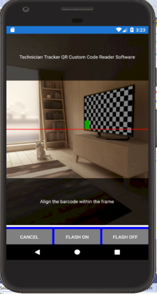

# ZXing-Scanner-Overlay-with-Torch-Buttons
Add ZXing cutom Overlay with buttons to turn Torch On and Off
This was tested on Android Phone Version 9.1
Couldn't test on Iphone if you could test it on Mac or Iphone please advise.
This is my first real post with code.
Unfortunately after downloading you must remove the dashes aka rename the folder after extracting removing the dashes(-) otherwise you get illegal characters 

## Support

If this project saved you some time, you can leave a tip at
[ko-fi.com/dwainhsnickles](https://ko-fi.com/dwainhsnickles) (cards, no account needed) or
[paypal.me/YTDPlatinum](https://paypal.me/YTDPlatinum). Bug reports and pull requests are welcome too.
